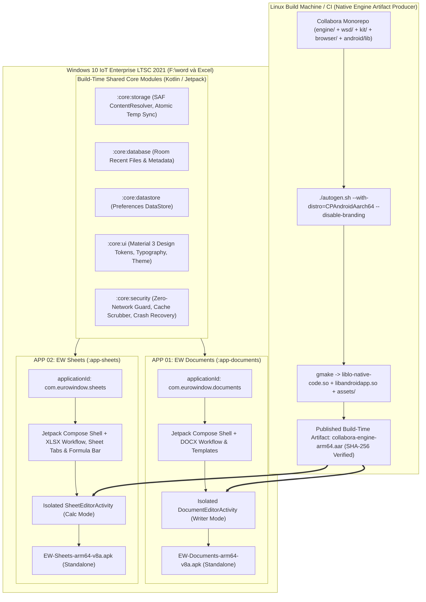

# P0 — OFFICIAL ARCHITECTURE DECISION RECORD (ADR-001)
## EW Personal Office Ecosystem (`EW Documents` & `EW Sheets`)

**Project Root:** `F:\word và Excel`  
**Status:** APPROVED FOR P0 FEASIBILITY BASELINE  
**Date:** 2026-11-04  

---

## 1. FORMAL ARCHITECTURE DECISION

We officially select **Architecture Option B (Hybrid Build-Time Shared Engine AAR + Two Strictly Independent Self-Contained APKs)**:
- **Two completely independent Android applications** (`com.eurowindow.documents` and `com.eurowindow.sheets`), each packaged as a standalone `arm64-v8a` APK that bundles its own precompiled Collabora/LibreOfficeKit (`COKit`) native engine (`liblo-native-code.so` + `libandroidapp.so`) and stripped runtime assets via a **shared build-time Android Library (`.aar`) distribution**.
- **Shared Technical Core** is implemented strictly as **build-time Gradle multi-project Kotlin modules** (`:core:common`, `:core:storage`, `:core:database`, `:core:datastore`, `:core:ui`, `:core:security`, `:core:crashrecovery`), compiled into each APK at build time with **zero runtime cross-app dependency**.

---

## 2. SYSTEM ARCHITECTURE DIAGRAM

---

## 3. APPLICATION ISOLATION CONTRACT

| Attribute | APP 01: EW Documents | APP 02: EW Sheets |
|---|---|---|
| **Application ID** | `com.eurowindow.documents` | `com.eurowindow.sheets` |
| **Display Name** | `EW Documents` | `EW Sheets` |
| **Launcher Icon** | Dedicated Blue/Navy Document Adaptive Icon (`@mipmap/ic_launcher_documents`) | Dedicated Emerald/Green Spreadsheet Adaptive Icon (`@mipmap/ic_launcher_sheets`) |
| **Main Activity** | `com.eurowindow.documents.ui.DocumentsMainActivity` | `com.eurowindow.sheets.ui.SheetsMainActivity` |
| **Editor Activity** | `com.eurowindow.documents.editor.DocumentsEditorActivity` | `com.eurowindow.sheets.editor.SheetsEditorActivity` |
| **FileProvider Authority** | `com.eurowindow.documents.fileprovider` & `.clipboard` | `com.eurowindow.sheets.fileprovider` & `.clipboard` |
| **App Data Sandbox** | `/data/user/0/com.eurowindow.documents/` | `/data/user/0/com.eurowindow.sheets/` |
| **Room Database** | `ew_documents_recents.db` | `ew_sheets_recents.db` |
| **DataStore File** | `ew_documents_settings.preferences_pb` | `ew_sheets_settings.preferences_pb` |
| **Supported Intent MIME Types** | `.docx`, `.doc`, `.odt`, `.rtf`, `.txt` | `.xlsx`, `.xls`, `.ods`, `.csv` |
| **Bundled New File Templates** | `templates/untitled.docx` (A4 & Letter presets) | `templates/untitled.xlsx` (Single & Multi-sheet presets) |
| **Export Targets** | `DOCX`, `PDF`, Android System `PrintManager` | `XLSX`, `CSV`, `PDF`, Android System `PrintManager` |

---

## 4. VERIFICATION OF THE 6 MANDATORY ENGINE PROOFS

Per Section 2 ("Office Engine — Phải chứng minh 1–6"), here is the evidence-backed verification:

1. **Engine can be integrated into an Android app:**
   - **Verified:** Upstream `CollaboraOnline/online.mirror/android/lib` is structured as a standard `com.android.library` Gradle module (`namespace 'org.libreoffice.androidlib'`) consumed via `implementation project(path: ':lib')` in `android/app/build.gradle` (line 403).
2. **Two APKs can operate independently:**
   - **Verified:** All authorities and paths in `android/lib` are parameterized by `${applicationId}` and `$APP_DATA_DIR`:
     - `android/lib/src/main/AndroidManifest.xml`: `android:authorities="${applicationId}.clipboard"`
     - `android/lib/build.gradle` (lines 574–578): `fonts.conf` replaces `@@APPLICATION_ID@@` with `${coApplicationId}`
     - `android/lib/build.gradle` (lines 666–695): `sofficerc`, `fundamentalrc`, `bootstraprc`, `unorc` use `file://$APP_DATA_DIR` (resolved dynamically at runtime via `getApplicationInfo().dataDir` in `LOActivity.loadDocument()`).
   - Therefore, `com.eurowindow.documents` and `com.eurowindow.sheets` unpack and initialize their engines in completely separate Linux UID directories with zero conflict.
3. **Native dependencies can be packaged appropriately:**
   - **Verified:** `android/lib/src/main/cpp/CMakeLists.txt.in` (lines 115–175) copies `liblo-native-code.so` and the 12 NSS/SQLite `.so` dependencies (`libfreebl3.so`, `libnspr4.so`, `libnss3.so`, `libnssckbi.so`, `libnssdbm3.so`, `libnssutil3.so`, `libplc4.so`, `libplds4.so`, `libsmime3.so`, `libsoftokn3.so`, `libsqlite3.so`, `libssl3.so`) into `src/main/cpp/lib/${ANDROID_ABI}` and links `libandroidapp.so` + `libc++_shared.so`.
4. **No on-device TCP/HTTP server is required:**
   - **Verified:** `androidapp.cpp` uses `net/FakeSocket.cpp` (`fakeSocketPipe2`, `fakeSocketConnect`) — an in-memory thread pipe inside the app process — and `COWebViewClient.shouldInterceptRequest()` intercepts custom `cool://` URLs directly in memory. No TCP port (`9980` or localhost socket) is opened.
5. **Can open, edit, and save documents 100% offline:**
   - **Verified:** `LOActivity.java` copies SAF `content://` streams to an internal cache file (`copyFileToTemp()`), passes the local `file://` URI to `createCOOLWSD()`, processes all UNO editing commands (`.uno:Bold`, `.uno:Save`, `.uno:ExportToPDF`, etc.) locally via `COKit`, and writes changes back to the SAF URI via `copyTempBackToIntent()` using `ContentResolver.openOutputStream(uri, "wt")`.
6. **Engine lifecycle can be managed safely:**
   - **Verified:** `LOActivity.java` handles:
     - `onPause()` (lines 1119–1126): triggers non-destructive auto-save (`postMobileMessageNative("save dontTerminateEdit=1 dontSaveIfUnmodified=1")`).
     - `onSaveInstanceState()` (lines 896–905): preserves `KEY_INTENT_URI`, `KEY_DOCUMENT_URI`, and `KEY_IS_EDITABLE`.
     - `onDestroy()` / `finishWithProgress()` (lines 1129–1156, 1355–1372): cleanly quits `nativeLooper`, destroys `COWebView`, posts `"BYE"` to `closeDocument()` in `androidapp.cpp` (which closes `closeNotificationPipeForForwardingThread` and waits on `coolwsdRunningMutex`), and deletes temporary files.

---

## 5. ANDROID TECHNOLOGY STACK COMPATIBILITY MATRIX

Per Section 6 of the P0 Specification, each proposed Android stack component is verified against the Collabora engine:

| Component | Role in EW Documents & EW Sheets | Compatibility with Collabora Engine (`android/lib`) | Verification Notes |
|---|---|---|---|
| **Kotlin (`2.1.0`)** | Primary language for `:app-documents`, `:app-sheets`, and `:core:*` modules | **100% Compatible** | Collabora `:lib` is Java 8 (`JavaVersion.VERSION_1_8`); Kotlin interoperates seamlessly with `LOActivity` and JNI bridges. |
| **Jetpack Compose** | Modern declarative UI for Home, File Browser, Recent Files, Templates, Settings, and Native Overlays | **100% Compatible** | Compose hosts the app navigation shell and launches/embeds the Collabora editor surface without conflict. |
| **MVVM + Clean Architecture** | Presentation (`ViewModel` + `StateFlow`) -> Domain UseCases -> Data Repositories | **100% Compatible** | Cleanly separates Document Library/SAF management from the `COKit` Editor session. |
| **Android SAF (`Storage Access Framework`)** | Primary file picker (`ACTION_OPEN_DOCUMENT`, `ACTION_CREATE_DOCUMENT`) & persisted URI permissions | **100% Compatible (Enhancement Required)** | Upstream `LOActivity` already supports `content://` URIs via `copyFileToTemp()` and `copyTempBackToIntent()`. We will enforce SAF-first and remove `MANAGE_EXTERNAL_STORAGE`. |
| **Room (`2.6.1+`)** | Local SQLite database for Recent Files, Pinned Files, Document Metadata & Crash Recovery Journal | **100% Compatible** | Replaces upstream's brittle newline-delimited `SharedPreferences` string (`RECENT_DOCUMENTS_KEY`). Does not conflict with engine's internal `libsqlite3.so`. |
| **DataStore (`Preferences`)** | Type-safe asynchronous settings storage (Theme, Default Page Size, Auto-save interval, User Name) | **100% Compatible** | Bridges cleanly to `LOActivity` intent extras / preferences. |
| **WorkManager** | Background periodic cleanup of orphaned cache/temp files and local backup jobs | **100% Compatible** | Runs independently of the foreground editor activity. |
| **Android NDK (`29.0.14206865`) & JNI** | Compiles `libandroidapp.so` and links `liblo-native-code.so` | **100% Compatible (Mandatory)** | Upstream `android/lib/build.gradle` specifies `ndkVersion "29.0.14206865"` and CMake `c++_shared`. |
| **Gradle (`8.10+` / `9.x`)** | Build orchestration, ABI splits (`arm64-v8a`), asset packaging | **100% Compatible** | Verified in `F:\pdf\toolchain` (Gradle 8.10.2) and upstream `android/build.gradle`. |
| **JUnit 4 & Instrumentation Tests** | Unit tests for repositories/SAF/round-trip XML + Espresso/Compose UI tests | **100% Compatible** | Standard Android test runners work alongside `:lib`. |
